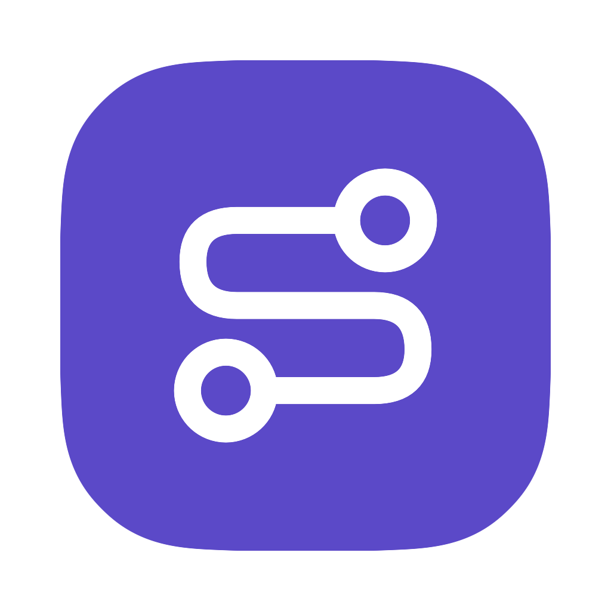
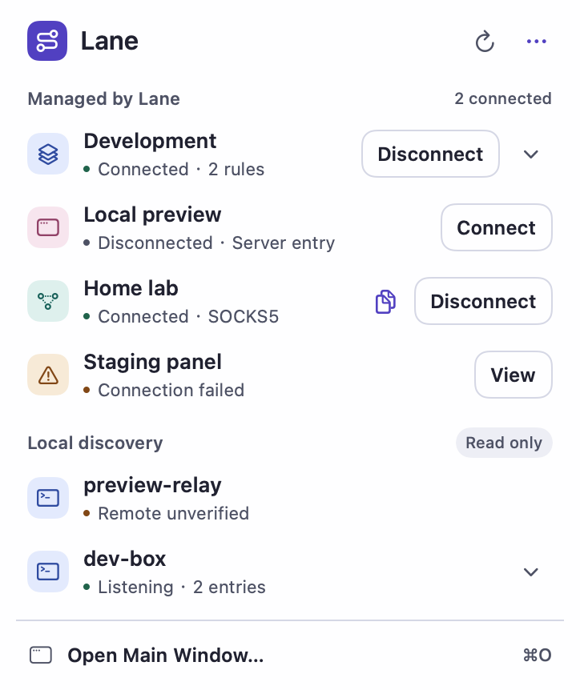
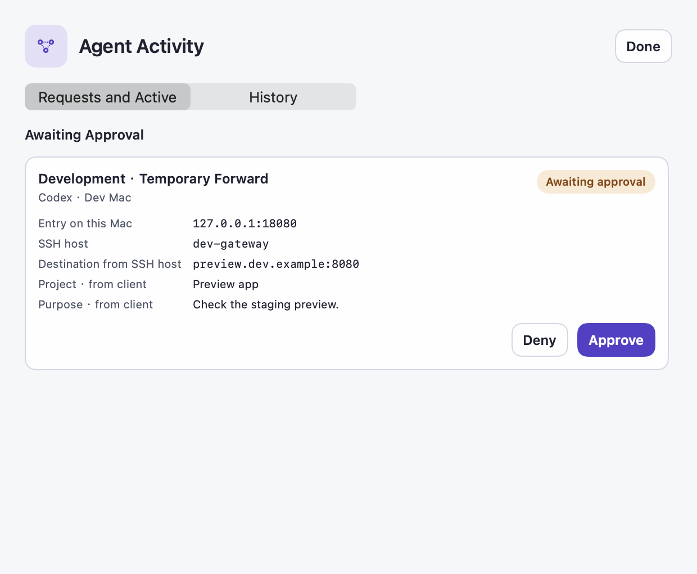

<p align="center">
  
</p>
<h1 align="center">Lane</h1>
<p align="center"><strong>SSH tunnel manager for macOS</strong></p>
<p align="center">Connect and copy an address from the menu bar. Open the main window to configure routes, inspect existing tunnels, or review an Agent request.</p>
<p align="center">
  <a href="README.zh-CN.md">简体中文</a> ·
  <a href="#get-lane">Get Lane</a> ·
  <a href="docs/usage.md">User Guide</a> ·
  <a href="docs/agent-mcp.md">Agent MCP</a>
</p>
<p align="center">
  <a href="https://github.com/dong4j/lane/actions/workflows/macos.yml"></a>
</p>

<picture>
  <source media="(prefers-color-scheme: dark)" srcset="docs/screenshots/main-dark.png">
  
</picture>

## What Lane does

- **Manage tunnels from the menu bar.** Connect, disconnect, and copy individual addresses even when the main window is closed.
- **See where the traffic goes.** Local `-L`, remote `-R`, and dynamic `-D` forwarding have distinct route diagrams, directional animations, and notes.
- **Find OpenSSH forwards that are already running.** Lane groups discovered listeners by SSH process. External sessions are read-only and server-side listeners are marked unverified when Lane only sees the declaration.
- **Let Agents request a local forward through MCP.** Pair a client, share a loopback rule, or approve a temporary route. Review who requested it, end a lease, and look up its history in Lane.
- **Bring existing profiles.** Preview imports from `~/.ssh/config`, Lane or Porthole backups, and compatible Codinn exports. Lane runs OpenSSH and uses macOS Keychain for saved credentials.

| Menu bar | Agent approval |
| --- | --- |
|  |  |

Screenshots show Lane's native views with sample data. The app supports light and dark appearance, English, and Simplified Chinese.

## Get Lane

Lane requires **macOS 14 or later**. On Apple silicon, sign in to GitHub, open a successful [macOS CI run](https://github.com/dong4j/lane/actions/workflows/macos.yml?query=branch%3Amain), and download `Lane-macOS-arm64.zip` from **Artifacts**. CI builds use an ad-hoc signature. If macOS blocks the downloaded build, use the source build.

The source build uses Swift 6. Run these commands on your Mac.

```sh
git clone https://github.com/dong4j/lane.git
cd lane
./scripts/build-app.sh release
open .build/Lane.app
```

In Lane, choose **New Tunnel**, enter an SSH alias or hostname, and add a forwarding rule. For example, with local forwarding, listen on `127.0.0.1:15432` and set `db.internal:5432` as the destination as seen from the SSH host. Connect and copy the local address into your database client. See the [user guide](docs/usage.md) for remote forwarding, SOCKS5, and troubleshooting.

## Agent MCP

Open **Settings → Agent Access**, create a pairing, and copy one of the **Codex**, **Claude Code**, **Cursor**, or **Generic** recipes. Generic includes both a `mcpServers` JSON entry and the individual `command`, `args`, and optional `env` fields for any local stdio client.

New pairings start read-only. Enable requests for both the app and the client when you want to let that client request a route. Temporary destinations and existing external forwards require approval in Lane. [Setup and tool reference](docs/agent-mcp.md)

## Contributing and license

See [Contributing](CONTRIBUTING.md) for build, compatibility checks, and UI fixtures. Report vulnerabilities through [private reporting](SECURITY.md).

Lane is available under the [MIT License](LICENSE). Parts of its OpenSSH core and tests are adapted from [Porthole](https://github.com/bryan31/porthole), with the upstream [MIT notice](docs/Porthole-MIT.txt) included in source and app builds. Design assets include [Lucide and Feather notices](docs/design/Lucide-LICENSE.txt).
