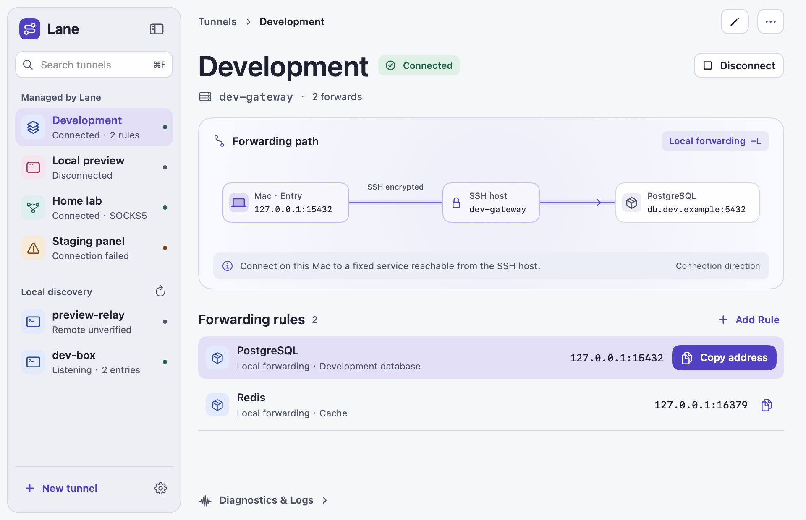

<p align="center">
  
</p>
<h1 align="center">Lane</h1>
<p align="center"><strong>SSH tunnel manager for macOS</strong></p>
<p align="center">Connect and copy an address from the menu bar. Open the main window to configure routes, inspect existing tunnels, or review Agent activity.</p>
<p align="center">
  <a href="README.zh-CN.md">简体中文</a> ·
  <a href="#get-lane">Get Lane</a> ·
  <a href="docs/usage.md">User Guide</a> ·
  <a href="docs/agent-mcp.md">Agent MCP</a>
</p>
<p align="center">
  <a href="https://github.com/dong4j/lane/actions/workflows/macos.yml"></a>
</p>

<picture>
  <source media="(prefers-color-scheme: dark)" srcset="docs/screenshots/main-dark.png">
  
</picture>

## What Lane does

- **Manage tunnels from the menu bar.** Connect, disconnect, and copy individual addresses even when the main window is closed.
- **See where the traffic goes.** Local `-L`, remote `-R`, and dynamic `-D` forwarding have distinct route diagrams, directional animations, and notes.
- **Find OpenSSH forwards that are already running.** Lane groups discovered listeners by SSH process. External sessions are read-only and server-side listeners are marked unverified when Lane only sees the declaration.
- **Let Agents request a local forward through MCP.** Enable Agent Access and copy a setup for your client. Review who requested a route, end a lease, and look up its history in Lane.
- **Bring existing profiles.** Preview imports from `~/.ssh/config`, Lane or Porthole backups, and compatible Codinn exports. Lane runs OpenSSH and uses macOS Keychain for saved credentials.


Screenshots show Lane's native views with sample data. The app supports light and dark appearance, English, and Simplified Chinese.

## Get Lane

The official build supports **Apple silicon** Macs running **macOS 14 or later**. Get the latest Developer ID-signed and Apple-notarized build from [GitHub Releases](https://github.com/dong4j/lane/releases/latest). Download `Lane-<version>-macOS-arm64.zip` and `SHA256SUMS.txt` from the same release. Verify the zip with `shasum -a 256 -c SHA256SUMS.txt`, unzip it, and move `Lane.app` to Applications.

To build from source, use Swift 6. Signed-in contributors can also download an ad-hoc test build from a successful [macOS CI run](https://github.com/dong4j/lane/actions/workflows/macos.yml?query=branch%3Amain).

```sh
git clone https://github.com/dong4j/lane.git
cd lane
make run
```

Use `make build` to package the Debug app at `.build/Lane.app`. Quit the running app first when you want `make run` to launch a fresh build.

In Lane, choose **New Tunnel**, enter an SSH alias or hostname, and add a forwarding rule. For example, with local forwarding, listen on `127.0.0.1:15432` and set `db.internal:5432` as the destination as seen from the SSH host. Connect and copy the local address into your database client. See the [user guide](docs/usage.md) for remote forwarding, SOCKS5, and troubleshooting.

## Agent MCP

Open **Settings → Agent** and turn on **Allow Agent access**. Copy and run the command for **Codex** or **Claude Code**, or copy the **Generic MCP** JSON configuration for another local stdio client.

Agent Access is off by default. Once enabled, Agents can use saved loopback forwards, open temporary loopback forwards through saved SSH hosts, or reuse verified external listeners. See current sessions and audit history in **Agent Activity**. Turning access off ends active Agent leases. [Setup and tool reference](docs/agent-mcp.md)

## Contributing and license

See [Contributing](CONTRIBUTING.md) for build, compatibility checks, and UI fixtures. Report vulnerabilities through [private reporting](SECURITY.md).

Lane is available under the [MIT License](LICENSE). Parts of its OpenSSH core and tests are adapted from [Porthole](https://github.com/bryan31/porthole), with the upstream [MIT notice](docs/Porthole-MIT.txt) included in source and app builds. Design assets include [Lucide and Feather notices](docs/design/Lucide-LICENSE.txt).
