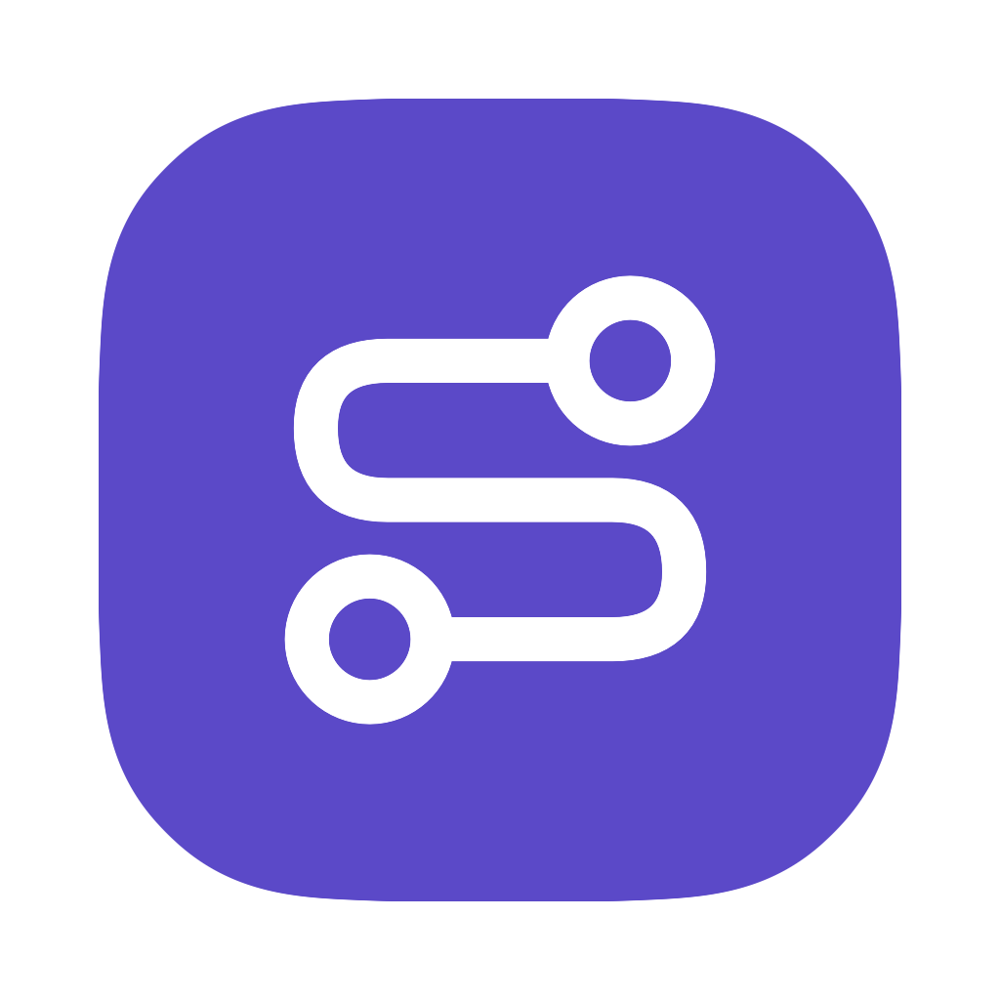
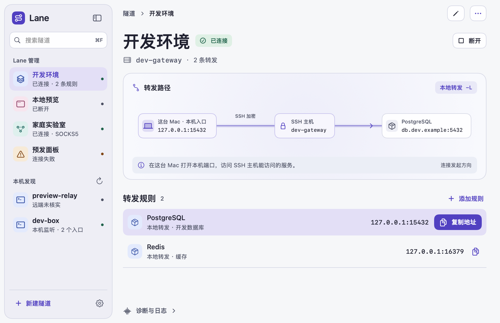
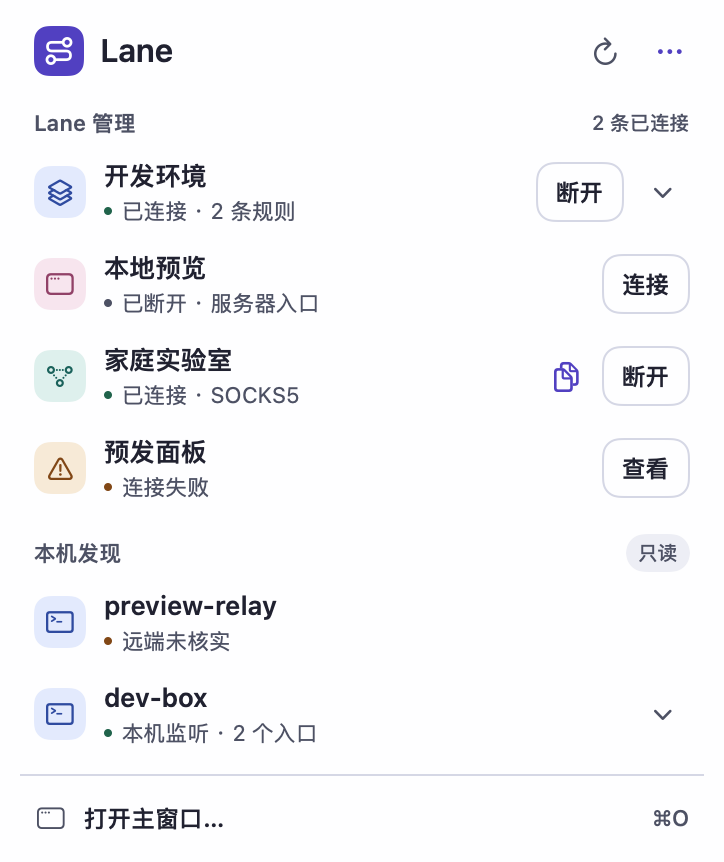

<p align="center">
  
</p>
<h1 align="center">Lane</h1>
<p align="center"><strong>macOS 原生 SSH 隧道管理工具</strong></p>
<p align="center">平时从菜单栏连接和复制地址。打开主窗口可配置转发、查看已有隧道和 Agent 活动。</p>
<p align="center">
  <a href="README.md">English</a> ·
  <a href="#安装">安装</a> ·
  <a href="docs/usage.zh-CN.md">使用指南</a> ·
  <a href="docs/06-agent-mcp.md">Agent MCP</a>
</p>
<p align="center">
  <a href="https://github.com/dong4j/lane/actions/workflows/macos.yml"></a>
</p>

<picture>
  <source media="(prefers-color-scheme: dark)" srcset="docs/screenshots/main-dark.zh-CN.png">
  
</picture>

## Lane 可以做什么

- **菜单栏里连隧道、拿地址。** 主窗口关闭后仍可连接、断开和复制每条规则的入口。
- **看清连接往哪走。** 本地 `-L`、远程 `-R` 和动态 `-D` 转发各有路径图、方向动效和用途说明。
- **查看已经运行的 OpenSSH 转发。** 同一个 SSH 进程的多个入口归到一组。外部会话为只读，远端只有配置声明时会标为未核实。
- **让 Agent 通过 MCP 申请本地转发。** 开启 Agent 接入并复制客户端配置，即可在 Lane 里查看申请、结束连接并追溯历史。
- **继续使用现有配置。** 支持预览导入 `~/.ssh/config`、Lane 或 Porthole 备份，以及兼容的 Codinn 导出。Lane 使用 OpenSSH，已保存的凭据由 macOS 钥匙串管理。



截图来自 Lane 的原生界面，使用演示数据。应用支持浅色、深色、英文和简体中文。

## 安装

Lane 需要 **macOS 14 或更高版本**。**Apple 芯片**的正式安装包在 [GitHub Releases](https://github.com/dong4j/lane/releases) 中发布。下载同一版本的 `Lane-<version>-macOS-arm64.zip` 和 `SHA256SUMS.txt`，运行 `shasum -a 256 -c SHA256SUMS.txt`，解压后将 `Lane.app` 移到「应用程序」。

首个版本发布前，可以使用 Swift 6 从源码构建。登录 GitHub 后也可在成功的 [macOS CI 构建](https://github.com/dong4j/lane/actions/workflows/macos.yml?query=branch%3Amain)中下载采用临时签名的测试包。

```sh
git clone https://github.com/dong4j/lane.git
cd lane
make run
```

`make build` 可单独打包调试版到 `.build/Lane.app`。需要用 `make run` 启动刚构建的版本时，先退出当前运行的 Lane。

打开 Lane，选择「新建隧道」，填写 SSH 别名或主机名并添加转发。比如用本地转发在 `127.0.0.1:15432` 监听，将目标设为 SSH 主机可访问的 `db.internal:5432`。连接成功后，把本机地址复制到数据库客户端。远程转发、SOCKS5 和排障见[使用指南](docs/usage.zh-CN.md)。

## Agent MCP

打开「设置 → Agent 接入」，开启总开关后复制并运行 **Codex** 或 **Claude Code** 的命令。其他支持本机 stdio 的客户端可以使用「通用 MCP」复制完整 JSON 配置。

Agent 接入默认关闭。开启后，Agent 可使用已保存的环回转发、通过已配置的 SSH 主机建立临时环回转发，或引用已核实的外部入口。在「Agent 活动」中可查看当前会话和历史记录。关闭开关会结束当前 Agent 会话。[接入与工具说明](docs/06-agent-mcp.md)

## 贡献与许可

构建、回归测试和界面预览见[贡献指南](CONTRIBUTING.md)。安全问题请通过[私密渠道](SECURITY.md)报告。

Lane 采用 [MIT 许可](LICENSE)。部分 OpenSSH 核心代码和测试来自 [Porthole](https://github.com/bryan31/porthole)，其 [MIT 声明](docs/Porthole-MIT.txt)随源码和应用分发。设计原型另附 [Lucide 和 Feather 的许可](docs/design/Lucide-LICENSE.txt)。
