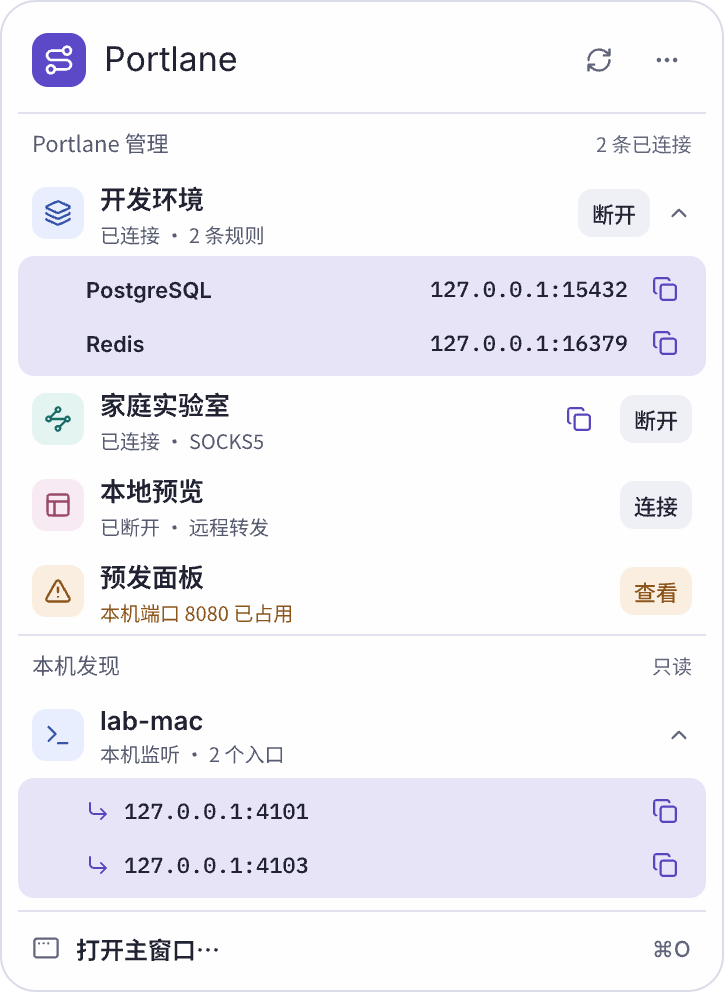
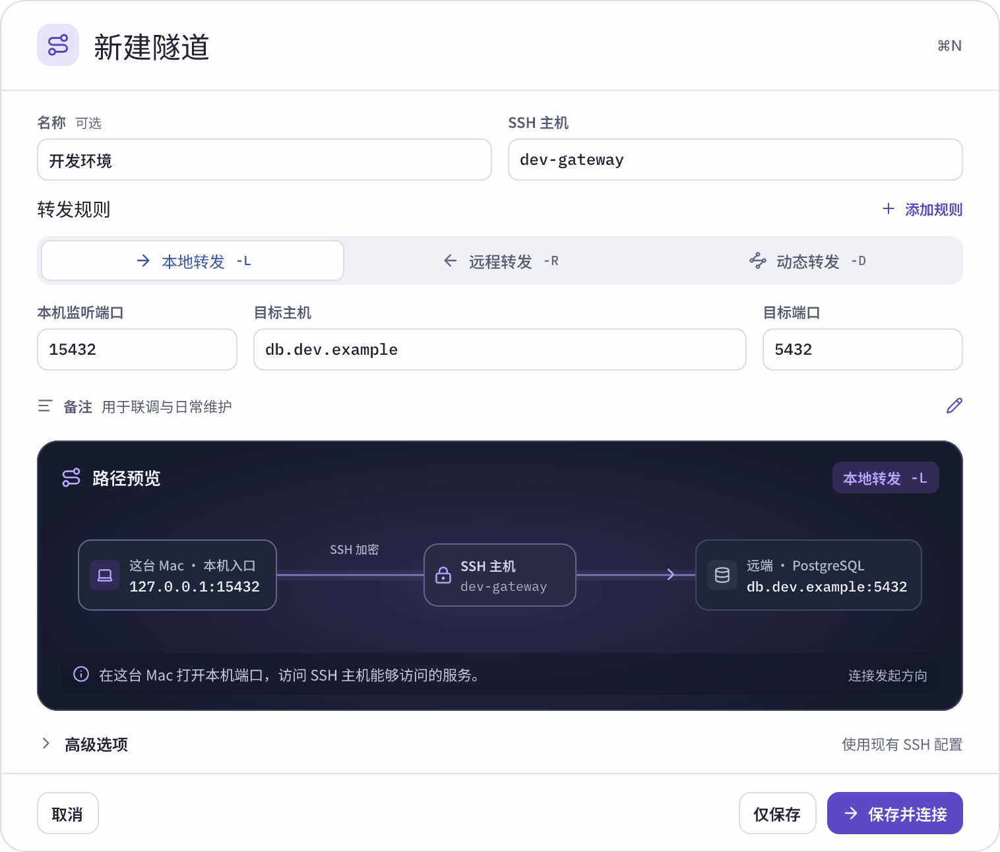

# Portlane 产品与交互方案

打开数据库客户端时，你可能记不清开发库的本机端口是 `5432` 还是 `15432`。点开菜单栏的 Portlane，展开“开发环境”，点 PostgreSQL 旁的复制按钮，就可以回到客户端。应用的主窗口可以一直关着。

已确认，菜单栏负责连接和取地址，主窗口主要用于配置和排障。新增需求是把本机已有的外部 SSH 隧道也放进这两个入口。首版提议以只读方式展示。[原型索引](README.md)

窗口布局、控件尺寸和动效以 [UI v2 设计交接](04-ui-v2.md) 为准。

## 菜单栏

- 点击菜单栏图标，看到各隧道名称、文字状态和当前可用操作。一条规则直接提供复制，多条规则点名称展开。展开的规则留在原位，用户连续复制两个地址时面板保持打开。
- Portlane 管理的隧道可以点“连接”或“断开”。等待认证时，这个位置改为“继续认证”，自动重连时可以取消等待。故障行的“查看”定位到主窗中出错的隧道和规则。
- “已复制”的反馈出现在触发按钮原位，随后还原。打开主窗口在底部。设置与退出收进右上角菜单，批量操作留给主窗口的多选场景，首版无需在菜单栏预留按钮。
- 四条样例在同一面板内展示。条目多时列表单独滚动，底部入口固定。状态改变时维持顺序、展开项和键盘焦点。
- 同时存在受管和外部会话时，显示“Portlane 管理”和“本机发现 · 只读”两组。外部会话可展开、可复制入口。已连接计数只统计受管隧道，外部条目的状态按本机观测结果显示。

## 主窗口

侧栏放受管隧道、本机发现、搜索、新建与设置。点击隧道切换详情，连接和断开使用明确的按钮。详情依次显示当前状态、所选规则的路径和可复制地址，底部可展开诊断。[浅色稿](design/previews/v2/main-light.png) · [深色稿](design/previews/v2/main-dark.png)

有多条规则时，初始选择第一条已启用规则。点击另一条规则更新路径，切回隧道时恢复本次会话的选中规则。规则行持续显示服务名、备注、监听地址和复制按钮。未命名规则使用端口和类型作标签。

| 规则类型 | 详情显示 | 剪贴板示例 | 目标含义 |
| --- | --- | --- | --- |
| 本地转发 `-L` | **本机入口**，按钮“复制地址” | `127.0.0.1:15432` | SSH 主机访问 `db.dev.example:5432`，数据库客户端连接 Mac 上的端口 |
| 远程转发 `-R` | **服务器监听地址**，按钮“复制服务器地址” | `127.0.0.1:18080` | 示例仅供服务器本机访问，流量转到 Mac 的 `127.0.0.1:3000` |
| 动态转发 `-D` | **本机 SOCKS 代理**，按钮“复制代理地址” | `socks5://127.0.0.1:1080` | 目标由使用该代理的客户端指定，编辑器隐藏固定目标字段 |

远程和本地的监听地址可以长得完全一样。“本机”和“服务器”要出现在对应字段和辅助功能标签里。监听地址设为通配时，详情保留配置值，本机复制给客户端时使用对应地址族的环回入口。远程稿的示例地址设为环回，对外可见范围以服务器配置为准。服务端状态未知时，界面标明“请求的服务器监听地址”。[远程转发稿](design/previews/v2/detail-remote.png) · [OpenSSH 转发说明](https://man.openbsd.org/ssh.1) · [服务器监听策略](https://man.openbsd.org/sshd_config.5#GatewayPorts)

## 本机发现

用户在终端、脚本或另一个图形工具里启动的 OpenSSH 转发，也出现在同一份列表中。原型里的 `lab-mac` 是一条外部 SSH 会话，下面有两个本机端口。每个入口都可以直接复制，详情标明目标由哪台 SSH 主机访问。外部条目提供刷新与查看，连接、断开、编辑和批量操作专用于 Portlane 自己管理的会话。[外部隧道详情](design/previews/v2/discovered-session.png)

| 本机能观察到什么 | 用户能看到什么 |
| --- | --- |
| `-L` 指定了入口与目标，且同一个 SSH 进程正在监听对应地址 | “本机监听中”、本机入口、可识别的 SSH 主机、启动参数声明的目标。同一进程的多条规则合并在一个可展开条目中。 |
| `-D` 与实际监听匹配 | 本机 SOCKS 代理地址，可以复制。它的访问目标由使用代理的客户端决定。 |
| 能确认是 SSH 进程的 TCP 监听，但规则来自配置或复用连接，无法匹配到目标 | 仍列出可复制的监听地址，方向或目标缺失时标“未知”。普通 TCP 服务和只有对外连接的交互式 SSH 登录不列为隧道。 |
| 能读到 `-R` 声明 | 列出“请求的服务器监听地址”和转发方向，标“远端未核实”。单凭 Mac 上的进程和监听表无法确认服务器已监听。 |
| 规则仅存在于磁盘配置，或第三方应用使用内嵌 SSH 库且没有可识别的 OpenSSH 进程 | 静态规则可走配置导入。内嵌实现、其他用户和虚拟机内的会话，首版无法保证发现。 |

全局搜索同时匹配两组的主机、端口和已知目标。若用户尚未创建受管隧道，但已有外部监听，直接显示发现结果。再次成功刷新后，已经退出的会话从列表移除。读取失败时保留上次结果并提示刷新失败。主动断开、退出清理和自动重连只作用于受管进程。绑定与转发方向的语义见 [OpenSSH 手册](https://man.openbsd.org/ssh.1)，本机进程与监听套接字的观测依据见 [lsof 字段说明](https://lsof.readthedocs.io/en/latest/manpage/)。

## 新建与编辑

1. 填 SSH 别名或 `user@host`，名称可选。直接使用现有别名时，由系统 OpenSSH 解析该主机的连接配置。平时用密钥或 agent 的人可以跳过认证设置。
2. 默认打开本地转发，填本机端口、目标主机和目标端口。切换为远程转发时，标签改为“服务器监听端口”“本机目标主机”“目标端口”。切换为动态转发时只保留代理监听设置。路径和一句用途说明随选择更新。规则备注可自定义。需要第二条规则再点“添加规则”。
3. 点“仅保存”只写配置。点“保存并连接”后在原选中隧道显示连接进度。输入不合法时就地说明，保留草稿并聚焦第一个错误字段。
4. 修改在线隧道时，如果改动影响连接参数，提交按钮写“保存并重连”，并指明会短暂中断这条隧道。只改名称或备注直接保存。退出编辑时可取消。

受管列表和本机发现都为空时，用户可以先切换查看三种转发示例，再新建隧道或导入 SSH 配置。导入前列出识别到的具体 Host 和规则，用户选择后保存。普通别名即使没有转发规则，仍可在新建表单中直接使用。导入零条要解释原因并提供“手动新建”。[首次使用稿](design/previews/v2/empty-library.png)

## 失败、认证与诊断

| 用户看到的状态 | 在当前界面可以做什么 |
| --- | --- |
| 已断开 | 连接。详情保留配置地址，文案标记“未监听”。菜单栏的可用入口随连接就绪出现。 |
| 正在连接 / 正在断开 | 显示进度和具体隧道名称。连接过程中可以取消，断开过程中等待进程结束。 |
| 等待验证 | 菜单栏和主窗口都能回到同一份密码、验证码或首次指纹确认提示。首次指纹展示主机和完整指纹供核对，指纹发生变化时停止连接。 |
| 已连接 | 表明 SSH 连接及所需转发已就绪。详情可以区分单条规则的待建立、已监听、已获服务器确认和失败。 |
| 等待重连 | 显示下一次尝试的时间，并提供“立即重试”和“取消重连”。主动断开的隧道保持关闭。 |
| 端口已占用 | 显示端口和已知占用进程。查不到进程时仍可编辑端口。主操作直接聚焦该规则的监听端口，保存后重连。 |
| 其他连接失败 | 按可用证据提示处理动作，例如认证失败时检查身份验证。无法分类时保留原始 SSH 信息到“诊断与日志”。 |

端口冲突稿中的 `node` 是样例。用户可以换端口，也可以自行关闭占用程序后重试。诊断里保留技术细节、必要的路径说明及 SSH 命令。首屏持续显示当前阻塞连接的那条原因，避免把用户留在日志列表里。[端口冲突稿](design/previews/v2/port-conflict.png) · [日志展开稿](design/previews/v2/diagnostics.png)

## macOS 视觉与操作约定

| 项目 | 设计约定 |
| --- | --- |
| 窗口尺寸 | 原型主窗 960 × 620 pt，菜单栏面板 362 pt 宽，编辑表单 758 pt 宽。实现允许调整主窗尺寸。宽度不足时地址与复制分行，较长主机名可选择、展开和复制。 |
| 文字 | 实现使用系统界面字体，地址、端口和 SSH 别名使用系统等宽字体。原型用 Noto Sans SC、Inter 和 IBM Plex Mono 区分这两类内容。 |
| 颜色 | 侧栏采用内嵌浅灰或石墨色材料，按钮为靛紫强调色。路径用淡紫、粉和青绿辅助区分三种转发。成功和警告都配符号与文字。默认跟随系统外观。 |
| 键盘 | `⌘N` 新建，`⌘F` 搜索，方向键选择隧道，Tab 到达规则和复制动作。编辑器 Return 执行标明的默认操作，Esc 取消。名称行、开关与复制按钮有独立的焦点和可读名称。 |
| 动效 | 切换规则时路径短淡入，已就绪规则和示意画面播放发起方向。“减少动态效果”开启时停止光点并即时更新。复制反馈保持原控件大小。 |
| 系统控件 | 实现优先使用原生窗口工具栏、可选中列表、Sheet、文本字段和 SF Symbols。Pen 中的 Lucide 图标用于表达动作语义。 |

平台参考见 [Apple 侧栏指南](https://developer.apple.com/design/human-interface-guidelines/sidebars)、[工具栏指南](https://developer.apple.com/design/human-interface-guidelines/toolbars) 和[辅助功能指南](https://developer.apple.com/design/human-interface-guidelines/accessibility)。
