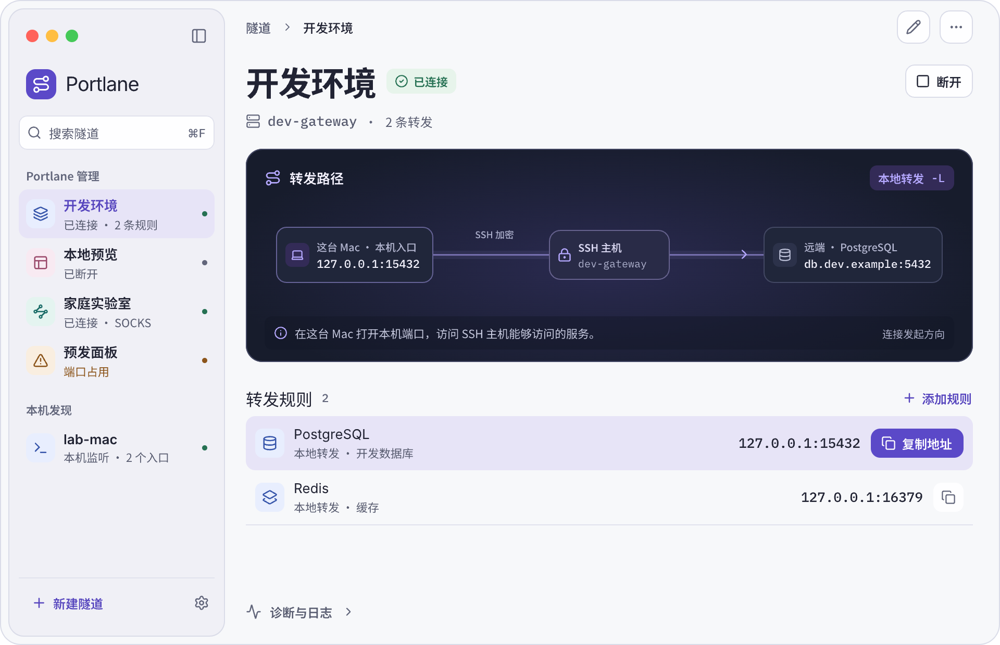
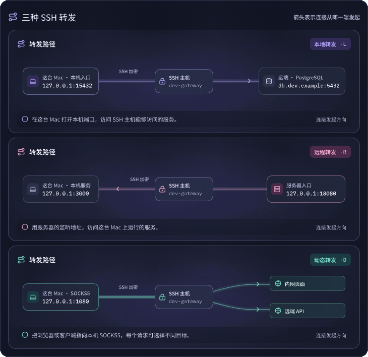

# Portlane UI v2

从[主窗口浅色稿](design/previews/v2/main-light.png)看整体，再看[三种转发的动效](design/previews/v2/route-motion.gif)。同一个 [Portlane.pen](design/Portlane.pen) 中，v2 位于原画板右侧，每张画板以 `V2 ·` 开头。原先的九张画板保留在左侧。v2 用作原生实现的视觉与交互基准，画板内使用演示数据。

## 画板

| 场景 | 预览 | 实现时对照的动作 |
| --- | --- | --- |
| 主窗口 | [浅色](design/previews/v2/main-light.png) · [深色](design/previews/v2/main-dark.png) | 点击规则更新路径。每条规则保留独立复制入口。 |
| 菜单栏 | [快速连接与复制](design/previews/v2/menu-bar.png) | 连接、断开、复制地址。受管与本机发现分组，后者可读、可复制。 |
| 新建和编辑 | [可点击预览](design/previews/v2/editor-switch.svg) · [本地](design/previews/v2/editor-local.png) · [远程](design/previews/v2/editor-remote.png) · [动态](design/previews/v2/editor-dynamic.png) | 切换类型时，端口字段、方向、端点和用途一起变更。名称、SSH 主机和自定义备注保留。 |
| 另外两种已连接详情 | [远程转发](design/previews/v2/detail-remote.png) · [动态转发](design/previews/v2/detail-dynamic.png) | 显示归属明确的复制按钮。远程地址属于 SSH 服务器，代理地址属于 Mac。 |
| 本机发现 | [外部 SSH](design/previews/v2/discovered-session.png) | 从监听记录取本机入口，有匹配的启动参数时才画目标端。 |
| 恢复和诊断 | [端口冲突](design/previews/v2/port-conflict.png) · [展开日志](design/previews/v2/diagnostics.png) | 一键打开出错端口字段。诊断显示最近事件，并提供 SSH 命令和完整日志入口。 |
| 首次使用 | [选择转发方式](design/previews/v2/empty-library.png) | 可先切换方向示例，再把所选类型带进新建表单。导入现有 SSH 配置仍从同一个窗口发起。 |
| 动效对照 | [5.5 秒循环](design/previews/v2/route-motion.gif) · [静态画板](design/previews/v2/route-comparison.png) | Pen 对照板引用三种可编辑路线组件。可单独查看 [本地](design/previews/v2/route-local.png)、[远程](design/previews/v2/route-remote.png)、[动态](design/previews/v2/route-dynamic.png) 组件。 |

## 线怎样走

| 模式 | 发起端与方向 | 解释与示例 |
| --- | --- | --- |
| **本地转发** `-L` | Mac 左侧发起，经过 SSH 主机，到右侧的固定服务。 | 在 Mac 上连接 `127.0.0.1:15432`，访问 SSH 主机能访问的开发库 `db.dev.example:5432`。 |
| **远程转发** `-R` | SSH 服务器右侧发起，经过 SSH 主机，回到左侧的 Mac 服务。 | 在 SSH 服务器使用 `127.0.0.1:18080`，访问 Mac 的 `127.0.0.1:3000`。服务端策略决定这个监听能被谁访问。 |
| **动态转发** `-D` | Mac 左侧发起，经过 SSH 主机，右侧按请求走向不同目标。 | 在支持 SOCKS5 的客户端填写 `socks5://127.0.0.1:1080`。动效轮流走向两个示例目标，表单只有本机代理端口。 |

箭头和光点表示**连接发起方向**。Mac 和 SSH 主机之间的连线标注“SSH 加密”，主机以外的服务侧继续用线表示到达路径。标签、箭头和端点所属在静态画面中同样完整，颜色只辅助分类。规则用途说明在路径下方，自定义备注出现在规则行和编辑表单。转发语义以 [OpenSSH 手册](https://man.openbsd.org/ssh.1) 为准，表现参考 [Porthole 上游路径组件](https://github.com/bryan31/porthole/blob/e6fa8c263798f71d1b98c4993051665b68d18800/Sources/Porthole/Views/RouteDiagram.swift) 和[首次使用示例](https://github.com/bryan31/porthole/blob/e6fa8c263798f71d1b98c4993051665b68d18800/Sources/Porthole/Views/MainWindow.swift#L318-L406)。

## 动效与状态

- **同一表单内切换。** 在 Pen 桌面版打开 `V2 · 新建隧道 · 可点击预览`，点击内嵌预览，再点表单内的三种转发方式。也可在浏览器中打开[本地预览文件](design/previews/v2/editor-switch.svg)。已在 Pen 的内嵌浏览器中逐项点击验证，`Tab` 和回车也能切换。预览使用样例字段，连接和保存是原生实现中的动作。
- **原型可直接播放。** Pen 的动效层引用同目录 [route-pulse.glsl](design/route-pulse.glsl)。在 Pen 中打开 `V2 · 三种转发 · 动效对照`，每次发起演示为 2.75 秒，动态转发每轮交替选择一个目标。导出的动图取两轮实际渲染，便于比较方向和节奏。
- **已连接与编辑预览。** 主窗只为当前选中的已就绪规则绘制光点。编辑器把动画明确标记为“路径预览”，有效字段即时更新节点。首次使用的“路径示例”使用样例地址。两处的动效演示均与网络请求无关。
- **等待与失败。** 正在连接、等待验证或重连时保留箭头与状态文字。断开后保留配置与虚线。端口占用时显示阻塞节点和修复动作。外部会话用“本机监听中”和证据来源表达观测范围，路径维持静态。
- **切换与无障碍。** 侧栏和规则的选中样式即时变更，详情和路径在约 180 ms 内交叉淡入淡出。切换相同类型的两条规则时，端点和用途也随各自的内容过渡。侧栏和菜单栏入口约 220 ms 展开或收起。启用“减少动态效果”时，各处即时切换，路径停止光点并保留箭头。VoiceOver 按“发起端 → SSH 主机 → 目标端”顺序朗读路径。复制反馈在原按钮位置显示。

## 原生实现基准

| 元素 | 尺寸与外观 |
| --- | --- |
| 主窗 | 默认 960 × 620 pt。侧栏宽 208 pt，距窗口边缘 8 pt，圆角 15 pt。Portlane 图标、名称与侧栏开关同排。收起后的恢复按钮位于详情区顶部。窗口收窄时让端点换行并保留复制操作。 |
| 菜单栏 | 362 pt 宽。受管与发现区按实际内容显示，溢出时滚动，底部“打开主窗口”固定。一个入口可直接复制，多入口行内展开。 |
| 编辑表单 | 758 × 646 pt。在真实窗口高度不足时，表单区滚动，操作区固定。一个模式选择器、一行端口字段和一块路径预览。输入无效时聚焦错误字段，图中的缺失值使用占位文字。 |
| 路径画布 | 主窗高度 205 pt、圆角 16 pt。Mac 固定在左、SSH 主机居中。远程转发反转发起方向。动态转发的两条分支表达可选目标。 |
| 色彩 | 浅色窗口 `#F7F8FA`、侧栏 `#F0F0F6`、路径画布 `#F9FAFD`。深色窗口 `#171A22`、侧栏 `#20232D`、路径画布 `#191E2D`。主窗、编辑器和首次使用示例从同一套语义色读取节点、描边和说明，三种转发使用各自的轨道色。 |
| 字体和控件 | 界面用系统字体，SSH 地址用系统等宽。SwiftUI 映射原生工具栏、菜单栏面板、表单、快捷键和状态控件。Pen 中的 Lucide 图标按语义换成 SF Symbols，保留尺寸、层级与对齐。 |
| 视觉验收 | 先对比默认尺寸的浅色和深色截图。再验收窄窗、长地址、键盘焦点、状态文案、复制反馈和降低动态效果。对照中心路径的端点、发起方向和交互顺序。 |

## 取材

- **Apple 的 macOS 设计系统。** 借鉴侧栏与工具栏从内容平面分出的层次，玻璃质感限于系统控件。窗口和路线底色都可以在原生控件上逐项对照。[Meet Liquid Glass](https://developer.apple.com/videos/play/wwdc2025/219/) · [Apple 材质指南](https://developer.apple.com/design/human-interface-guidelines/materials)
- **Little Snitch。** 借鉴把连接关系作为阅读焦点，再让用户下钻到具体规则。Portlane 用端点与方向说明表达端口转发。[Little Snitch Network Monitor](https://www.obdev.at/products/littlesnitch/index.html)
