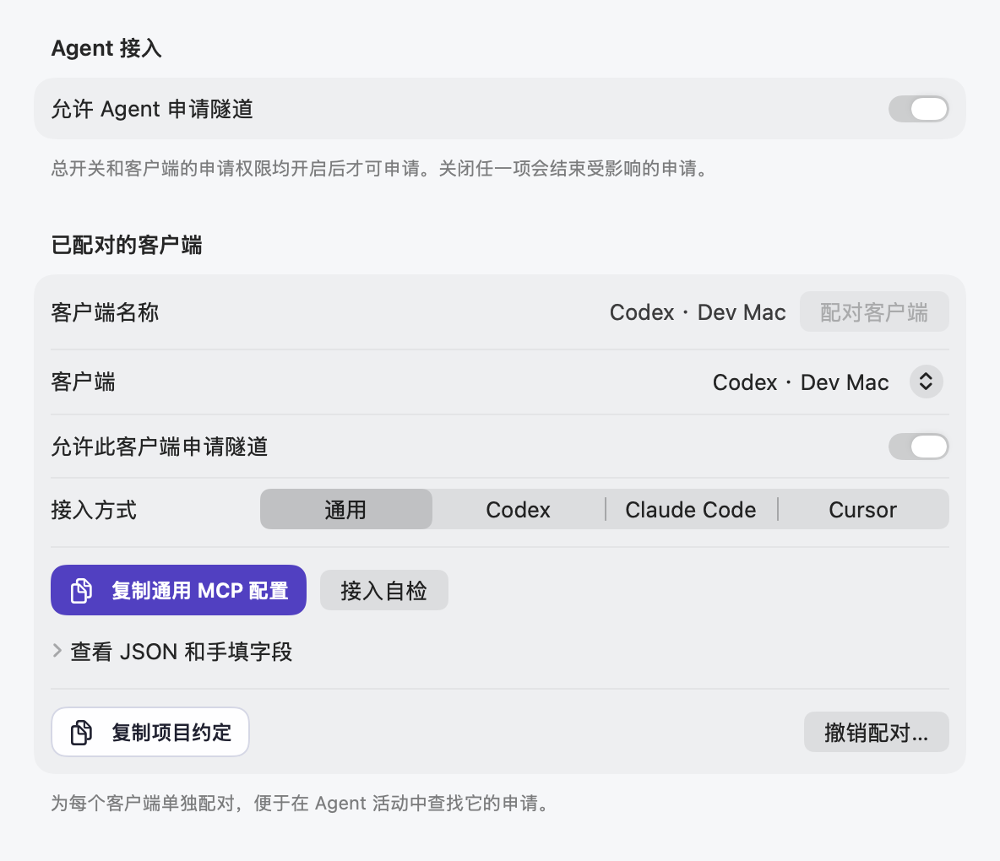

# Agent 接入与审计

[English](agent-mcp.md) · [主页](../README.zh-CN.md)

Lane 可以为本机 Agent 建立 SSH 本地转发。Agent 申请有期限的使用权，拿到就绪地址后继续工作，完成时释放。用户在主窗口审批和查历史，也可以从菜单栏复制地址或结束一份申请。

## 配对一个客户端

1. 启动 Lane，打开「设置 → Agent 接入」，为客户端取一个容易识别的名字并点击「配对客户端」。不同客户端分别配对，活动记录会显示各自的配对名。
2. 选择接入方式并复制。Codex 和 Claude Code 提供注册命令，Cursor 提供可合并到 `~/.cursor/mcp.json` 的配置。其他支持本机 stdio 的客户端使用「通用」。
3. 点击「接入自检」验证当前复制的助手能启动、完成 MCP 握手，并向 Lane 请求共享列表。客户端重新加载 MCP 配置后，调用 `lane_list` 即可检查自己的接入。
4. 配对后默认为只读。需要开隧道时，开启「允许 Agent 申请隧道」和该客户端的申请权限，再选择可以直接申请的共享规则。关闭任一权限会结束受影响的申请。撤销配对还会阻止该客户端继续查询。



### 通用 MCP 配置

点击「复制通用 MCP 配置」，即可获得当前安装位置和配对文件的绝对路径。把下面这种结构合并到客户端现有的 `mcpServers` 对象中。使用分列表单的客户端可以展开「查看 JSON 和手填字段」。

```json
{
  "mcpServers": {
    "lane": {
      "command": "/Applications/Lane.app/Contents/MacOS/Lane",
      "args": [
        "--mcp-stdio",
        "--credential-file",
        "/absolute/path/to/client.pairing"
      ]
    }
  }
}
```

| 客户端表单字段 | 填写内容 |
| --- | --- |
| 传输方式 | `stdio` |
| `command` | 复制设置里显示的可执行文件绝对路径。表单里直接粘贴路径。 |
| `args` | 分别填写 `--mcp-stdio`、`--credential-file` 和配对文件的绝对路径。 |
| `env` | 按上述方式填写时留空。也可仅传 `--mcp-stdio` 并在 `LANE_MCP_CREDENTIAL_FILE` 中填写同一个配对文件路径。 |

助手随应用打包，由 MCP 客户端拉起。Lane 主程序需要在该 Mac 的同一 macOS 用户下运行。移动应用后重新复制接入配置。配对文件位于用户私有目录，复制出的配置只有文件路径。能在同一 macOS 用户下读取该配对文件的进程可代表该配对身份调用。

## Agent 怎么使用

可在设置里复制「项目约定」，加入仓库的 `AGENTS.md` 或该客户端读取的项目指令。建议先查共享规则，再申请和轮询，任务结束时释放。一次工具调用超时后，用相同的 `idempotency_key` 和参数重试，可以取回同一份申请。

| 工具 | 操作 |
| --- | --- |
| `lane_list` | 列出已共享的规则和 `can_request`，供客户端选择。未共享的 SSH 配置无需公开。 |
| `lane_request` | 申请使用共享规则、临时目标或已确认的外部入口，返回申请编号和当前状态。 |
| `lane_status` | 以 `lease_id` 查询本配对的申请。状态为 `ready` 时，`lease.address` 可用于连接，`expires_at` 为到期时间。 |
| `lane_release` | 以 `lease_id` 释放本配对的申请，可重复调用。 |

共享规则示例中的 `rule_id` 取自 `lane_list`。`project` 可选，`purpose` 会显示给审批人。两个字段分别记录客户端提供的项目和用途，填写时应排除凭据。

```json
{
  "kind": "shared",
  "rule_id": "<shared-rule-id>",
  "idempotency_key": "preview-check-01",
  "project": "Preview",
  "purpose": "检查本机预览环境",
  "ttl_seconds": 900
}
```

- **临时目标**用 `kind: "temporary"`，填 `profile_id`、`listen_port`、`target_host` 和 `target_port`。`profile_id` 在设置的共享规则区复制，使用已保存 SSH 配置的认证。监听默认 `127.0.0.1`，可设 `listen_host: "::1"`。审批卡会显示本机入口、SSH 主机和 SSH 主机要访问的目标。
- **外部入口**用 `kind: "external"`，填 `external_address`，例如 `127.0.0.1:3113`。Lane 要能在本机观察到监听，并把它与外部 SSH 的 `-L` 参数对应。每次申请都需确认。释放、到期或人工结束只解除引用，外部 SSH 继续由原进程管理。

共享规则只启动选中的环回 `-L` 规则。共享和临时申请指向同一 SSH 配置及转发路径时，可以共用已建立的连接。最后一份申请结束后，Lane 回收由 Agent 发起的临时连接。已经手动连接并显式绑定到同一环回入口的隧道可以被复用，由用户继续管理。转发路径或 SSH 配置改动后，需要重新共享受影响的规则。

申请待审批时返回 `pending_approval`。审批后进入 `connecting`，重连期间返回 `reconnecting`。等待批准最多 5 分钟，首次连接最多 2 分钟。TTL 默认 15 分钟，从首次就绪开始计时，支持 1 到 3,600 秒。就绪表示 OpenSSH 已确认监听，目标服务是否可用由客户端按实际任务验证。

## 审计和排障

- 从主窗口或菜单栏打开「Agent 活动」。可审批、拒绝、复制已就绪地址、人工结束。历史支持按客户端、项目、地址或申请编号查找，并可展开查看申请、授权、连接、复用、重连和结束原因。
- 记录保存在 `~/Library/Application Support/Lane/Agent/activity.json`。SSH 凭据仍由 macOS 钥匙串及 OpenSSH 管理。Agent 审计只写管理动作和路径元数据。配对密钥、业务流量和 OpenSSH 运行日志分开放置。
- 正常退出会结束当前申请并关闭 Lane 管理的 SSH。重启可查询历史，上一进程留下的未结申请会标为已结束。异常退出后若仍观察到 SSH 监听，可以在「本机发现」核查。
- `read_only` 表示申请权限未开启。`not_paired` 表示当前配对文件缺失、无效或已撤销。`lane_unavailable` 表示需要在本机启动 Lane。`route_unavailable` 时在设置里核对当前共享规则或 SSH 配置。`external_unverified` 时在「本机发现」核对监听和转发参数。

stdio 支持 `2026-07-28` 的 `server/discover`，以及从 `2024-11-05` 到 `2025-11-25` 的 `initialize` 握手。客户端接入格式可查阅 [MCP stdio](https://modelcontextprotocol.io/specification/2026-07-28/basic/transports/stdio)、[Codex MCP](https://developers.openai.com/codex/mcp)、[Claude Code MCP](https://code.claude.com/docs/en/mcp) 和 [Cursor MCP](https://cursor.com/docs/context/mcp)。
