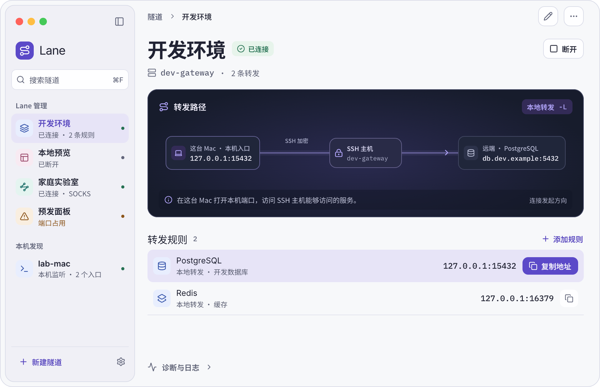

# Lane 开发与设计记录

[User Guide](usage.md) · [使用指南](usage.zh-CN.md) · [Agent MCP](agent-mcp.md) · [项目主页](../README.zh-CN.md)

一款原生 macOS SSH 隧道工具。打开菜单栏，连接开发环境，或从本机已有的 OpenSSH 转发复制入口。新增规则和排查问题时，再打开主窗口。

以下原型使用演示数据。当前应用图见[项目首页](../README.zh-CN.md)。



## 本机运行

需要 macOS 14 或更新版本及 Swift 6 工具链。在项目根目录执行以下命令。

```sh
make run
```

退出当前 Lane 后，带 `--demo` 启动可查看 v2 示例。演示配置、偏好和连接状态只保存在进程内。同一 macOS 用户重复打开 Lane 会唤回已经运行的主窗口。

```sh
open .build/Lane.app --args --demo
swift test
./scripts/test-loopback.py
```

回环测试需要 Python 3，使用临时密钥和本机 OpenSSH 服务。正式配置保存在 `~/Library/Application Support/Lane/tunnels.json`。开发时可通过 `LANE_DATA_FILE` 指定独立的配置文件。界面仍以 [Lane.pen](design/Lane.pen) 为视觉基准。

## 设置

从主窗口左下角或菜单栏的「更多操作」打开设置。

- **通用**可以切换外观和入口位置，设置登录启动及连接通知。语言在下次启动时切换，登录启动和通知权限由 macOS 管理。
- **连接**可以调整 Mac 唤醒后的恢复行为和 OpenSSH 客户端。验证后的路径从下一次连接或重连起使用。单条隧道是否随应用启动，在其编辑器的高级选项里设置。
- **Agent 接入**通过一个总开关启用，可复制 Codex、Claude Code 或通用 MCP 配置。在「Agent 活动」查看使用中和历史记录。[接入与审计说明](06-agent-mcp.md)
- **数据**可预览 `~/.ssh/config` 和本地 `Include`，合并 Lane、Porthole 或兼容 Codinn 的文件，也可从 Lane 或 Porthole 备份恢复整个隧道库。已保存的密码和私钥口令留在钥匙串。[导入和恢复](usage.zh-CN.md#导入导出和偏好设置)
- **关于**显示当前版本、项目主页和随包分发的第三方许可。

## 评审入口

| 想了解什么 | 去哪里看 |
| --- | --- |
| 迭代做到哪一步，怎样验收 | [迭代任务清单](08-iteration-checklist.md) |
| 下一版优先解决哪些问题 | [全项目审查](07-project-review.md) |
| 怎样打包、发布并走查真机 | [发布验收](09-release-verification.md) |
| Porthole 已经做对了什么，哪些地方值得改 | [上游分析与源码依据](01-porthole-analysis.md) |
| 日常怎样连接、复制地址和处理失败 | [产品与交互方案](02-product-design.md) |
| 终端或其他工具启动的 SSH 隧道能看到多少 | [本机发现与识别范围](02-product-design.md#本机发现) |
| 适合复用哪些代码，首版如何验收 | [实现路线与验收清单](03-implementation-plan.md) |
| 以哪套画板、尺寸和动效为实现基准 | [UI v2 设计交接](04-ui-v2.md) · [三种转发动效](design/previews/v2/route-motion.gif) |
| 在同一张表单里点选三种转发方式 | [可点击预览](04-ui-v2.md#动效与状态) |
| 调整布局、间距、文字或配色 | [可编辑的 Pen 原型](design/Lane.pen) |

## v1 存档

最新画板、路径动效和实现尺寸见 [UI v2](04-ui-v2.md)。下表保留第一版方案的静态预览。

| 画面 | 评审时可以试着回答的问题 |
| --- | --- |
| [主窗口 · 已连接](design/previews/main-light.png) | 想连接 PostgreSQL，哪一个地址要填进数据库客户端？ |
| [菜单栏 · 快速取用](design/previews/menu-bar.png) | 同一条 SSH 隧道有两个入口，能否直接取到 Redis 的地址？ |
| [本机发现 · 外部隧道](design/previews/discovered-session.png) | 同一外部 SSH 进程监听两个端口时，哪一端在 Mac，哪一端从 SSH 主机访问？ |
| [菜单栏 · 含本机发现](design/previews/discovered-menu.png) | 能否从同一个菜单复制受管和外部隧道的地址？ |
| [新建隧道 · 本地转发](design/previews/new-tunnel.png) | 已知 SSH 别名和数据库地址，能否在一页完成配置？ |
| [连接失败 · 端口占用](design/previews/port-conflict.png) | 哪个端口被占用，点哪里可以修复？ |
| [远程转发 · 服务器入口](design/previews/remote-forward.png) | 这个 `127.0.0.1` 属于哪台机器？ |
| [首次使用 · 隧道为空](design/previews/empty-library.png) | 有现成 SSH 配置的人如何开始？ |
| [主窗口 · 深色](design/previews/main-dark.png) | 在深色外观中，能否区分选择、连接和警告？ |

上游复用范围与原生版验收记录见 [实现路线](03-implementation-plan.md)。原型图标使用 Lucide，相关署名与条款见 [Lucide 许可文本](design/Lucide-LICENSE.txt) 和[上游许可来源](https://github.com/lucide-icons/lucide/blob/9cb3934c3628dfe3fbb34bc4c12209b2cee3a49f/LICENSE)。
