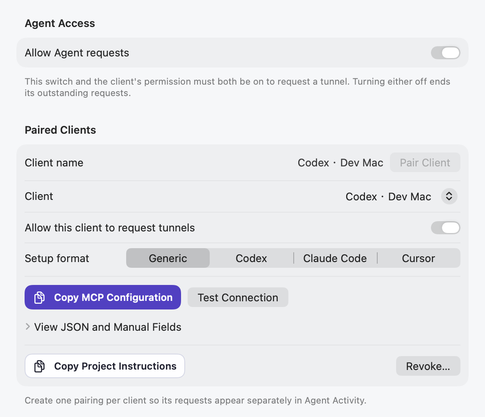

# Agent access over MCP

[简体中文](06-agent-mcp.md) · [Home](../README.md)

Lane can open time-limited SSH local forwards for an Agent on the same Mac. The Agent requests a lease, waits for a ready address, uses it, and releases it. The user can review the route, stop a lease, and see the audit history inside Lane.

## Pair a client

1. Open **Settings → Agent Access**, enter a recognizable name, and choose **Pair Client**. Make a separate pairing for each client you want to identify in the audit.
2. Pick a setup format and copy the recipe generated by Lane. **Codex** and **Claude Code** supply CLI registration commands. **Cursor** supplies a JSON snippet for `~/.cursor/mcp.json`. Other local stdio clients can use **Generic**.
3. Run **Test Connection** in Lane. After the client reloads its MCP configuration, have it call `lane_list` to check the pairing.
4. When you want a client to request tunnels, turn on **Allow Agent requests** and **Allow this client to request tunnels**. Share any loopback rules you want that client to request directly. Turning either switch off ends the affected leases. Revoking the pairing also stops queries from that client.



### Generic stdio setup

Merge the generated entry into the client's `mcpServers` object. Lane fills the absolute paths for the installation and pairing.

```json
{
  "mcpServers": {
    "lane": {
      "command": "/Applications/Lane.app/Contents/MacOS/Lane",
      "args": ["--mcp-stdio", "--credential-file", "/absolute/path/to/client.pairing"]
    }
  }
}
```

| Field | Value |
| --- | --- |
| Transport | `stdio` |
| `command` | The absolute executable path from Lane |
| `args` | `--mcp-stdio`, `--credential-file`, then the absolute pairing file path |
| `env` | Empty when passing `--credential-file`. Alternatively, pass just `--mcp-stdio` and set `LANE_MCP_CREDENTIAL_FILE` to the pairing file path. |

Keep Lane running under the same macOS account as the client. Copy the recipe again after moving or renaming the app. The recipe points at a private pairing file. Any same-account process that can read that file can use the pairing.

## Tool calls

Choose **Copy Project Instructions** in Agent Access to add the workflow to `AGENTS.md` or the equivalent file for your client.

| Tool | Use |
| --- | --- |
| `lane_list` | Return shared loopback rules and the pairing's `can_request` status. |
| `lane_request` | Request a shared rule, a temporary destination, or an observed external listener. |
| `lane_status` | Poll with the returned `lease_id`. Use `lease.address` when `state` is `ready`. |
| `lane_release` | Release a lease from this pairing with `lease_id`. It is safe to retry. |

For a shared rule, use an ID from `lane_list`. Repeat the same `idempotency_key` and inputs to recover that request after a timeout. The client supplies the `purpose` and optional `project` fields. Keep credentials out of both.

```json
{
  "kind": "shared",
  "rule_id": "<shared-rule-id>",
  "idempotency_key": "preview-check-01",
  "project": "Preview",
  "purpose": "Check the preview service",
  "ttl_seconds": 900
}
```

- **Temporary destination.** Use `kind: "temporary"`, a saved `profile_id`, `listen_port`, `target_host`, and `target_port`. Copy the profile ID in Agent Access. The listener defaults to `127.0.0.1`. For IPv6, set `listen_host` to `::1`. The approval shows the local address, SSH host, and destination.
- **External listener.** Use `kind: "external"` and `external_address`, for example `127.0.0.1:3113`. Lane must observe a matching loopback `-L` listener. Approve each request. Releasing the lease ends the reference while the original process retains ownership of the listener.

A shared request opens only the selected loopback `-L` rule. Compatible requests can share the same established forward. The last lease closes a forward started for Agents. Manually connected tunnels remain open under the user's control. If you change a saved SSH profile or route, review and share the affected rule again.

Approval can take up to five minutes, and initial connection up to two minutes. The default lease lasts 15 minutes from first readiness. Supported durations are 1 to 3,600 seconds. While the route is reconnecting, wait for `ready` before using the address again.

## Review and troubleshoot

Open **Agent Activity** from the window or menu bar to approve, deny, copy a ready address, or end a lease. History is searchable by pairing, project, address, and request ID. It includes approval, connection, reuse, and end events.

The audit is local under `~/Library/Application Support/Portlane/Agent/activity.json`. It contains route metadata and the client's stated purpose. Pairing credentials, SSH credentials, and forwarded traffic are stored or handled separately. Lane ends outstanding leases on quit and marks any left from an interrupted run as ended after restart.

| Response | What to check |
| --- | --- |
| `not_paired` | Verify the pairing is valid and that the configured file still exists. |
| `read_only` | Check the app-wide and per-client request permissions. |
| `portlane_unavailable` | Open Lane on this Mac, then retry. |
| `route_unavailable` | Verify the shared rule and the saved SSH profile. |
| `external_unverified` | Check the listener and arguments under Local discovery. |

The bundled stdio helper supports `server/discover` for MCP `2026-07-28` and `initialize` for revisions from `2024-11-05` through `2025-11-25`.
